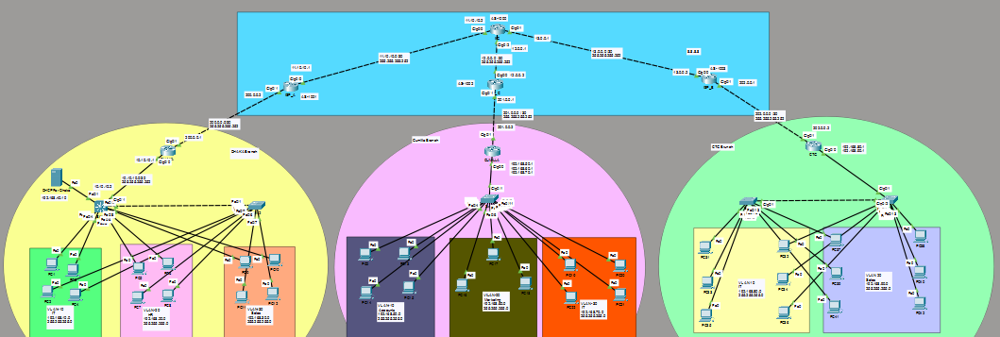

# ias-limited-multi-branch-wan-architecture

A multi-branch network project built in Cisco Packet Tracer. It connects three branches: Dhaka, Cumilla and Chattogram (CTG).

## Project Overview
- 3 branches, 5 switches, 3 branch routers, 3 ISP routers and 1 IIG router
- Each branch has its own VLANs, and PCs get IP addresses automatically
- All branches are connected by GRE tunnels

## Topology

## What I Did
**Dhaka Branch**
- VLAN 10 (IT), VLAN 20 (HR), VLAN 30 (Sales) and trunk link between SW1 and SW2
- SW1 works as a Layer 3 switch (inter-VLAN routing)
- DHCP server in VLAN 40, with DHCP relay
- ACL to protect the IT VLAN

**Cumilla Branch**
- VLAN 10 (Accounts), VLAN 20 (Marketing), VLAN 30 (IT)
- Router-on-a-stick, DHCP on the router, SSH remote access

**CTG Branch**
- VLAN 10 (IT), VLAN 20 (Sales)
- Router-on-a-stick and DHCP on the router

**Internet and Connections**
- NAT (PAT) on all three branch routers
- eBGP between the ISPs and the IIG router
- GRE tunnels from Dhaka to Cumilla and CTG
- OSPF over the tunnels

## Technologies Used
Cisco Packet Tracer, VLAN, Trunking, DHCP, NAT/PAT, BGP, OSPF, GRE, SSH, ACL

## Files in This Repository
- `Topology with Config.pkt`: Packet Tracer project file
- `Project command/`: router and switch commands
- `CCNA project.pptx`: project presentation
- `screenshots of Config/`: topology screenshots

## How to Open
1. Install Cisco Packet Tracer.
2. Download the `.pkt` file.
3. Open it in Packet Tracer.

## Video
[Watch on YouTube](https://youtu.be/Xi3_XvCKv7E)

## Author
[Irfan Ahmmed Sayam] | [https://www.linkedin.com/in/irfan-ahmmed-sayam-67325a439/]
